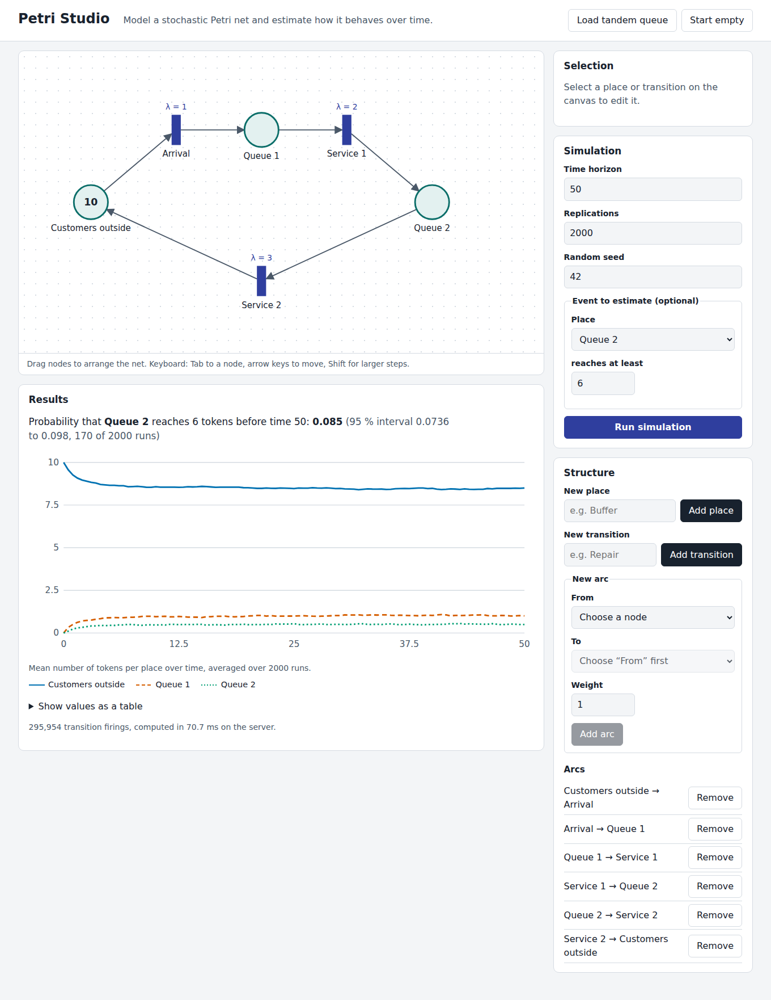

# Petri Studio

A web app for modelling **stochastic Petri nets** and estimating their behaviour by simulation.
React + TypeScript frontend, ASP.NET Core (.NET 8) backend.



You draw a net (places, transitions with exponential firing rates, weighted arcs), run a
Monte Carlo simulation on the server, and get

- the mean number of tokens per place over time (chart plus table), and
- the probability that a chosen place reaches a threshold before the time horizon,
  with a 95 % Wilson confidence interval.

The bundled example is a closed tandem queue. Its steady-state queue lengths match queueing
theory (about 1.0 and 0.5), which the backend tests check.

## Features

- **Editor:** drag nodes with mouse or touch; move them with the arrow keys; add, edit and remove
  places, transitions and arcs through forms. Invalid arcs (place → place) cannot be created.
- **Accessibility:** every action works without a mouse, visible focus, labelled controls, a
  data table as an alternative to the chart, colour-blind-safe chart colours with dash patterns,
  dark mode and `prefers-reduced-motion`. Checked automatically with axe-core in the test suite.
- **Responsive:** single-column layout on phones; installable via a web app manifest.
- **Validation:** instant feedback in the UI; the backend re-validates and returns RFC 9457
  problem details, which the UI shows message by message.
- **Reproducible:** every run takes a seed; the same seed gives the same result.

## Architecture

```
frontend/  React 18, TypeScript (strict), Vite, Vitest, Testing Library, axe-core, ESLint, Prettier
  src/model/       net types, reducer, client-side validation (pure functions, unit-tested)
  src/api/         typed API client, problem-details error handling
  src/hooks/       useSimulation: one request at a time, cancels stale requests
  src/components/  NetCanvas (SVG editor), Inspector, StructurePanel, SimulationPanel, ResultsView
backend/   ASP.NET Core minimal API, xUnit
  PetriStudio.Api/    Simulator (Gillespie direct method), NetValidator, endpoints
  PetriStudio.Tests/  simulator, validator and HTTP integration tests
docs/adr/  architecture decision records
```

Design decisions are recorded in [`docs/adr`](docs/adr).

## Run locally

Requirements: Node.js 22, .NET 8 SDK.

```bash
# Terminal 1: backend on http://localhost:5080
cd backend/PetriStudio.Api
dotnet run

# Terminal 2: frontend on http://localhost:5173 (proxies /api to the backend)
cd frontend
npm install
npm run dev
```

## Tests and checks

```bash
cd frontend && npm run lint && npm run typecheck && npm test
cd backend && dotnet test
```

GitHub Actions runs all of these on every push and pull request.

## API

`POST /api/simulate`

```json
{
  "net": { "places": [...], "transitions": [...], "arcs": [...] },
  "horizon": 50,
  "replications": 2000,
  "seed": 42,
  "target": { "placeId": "p_q2", "threshold": 6 }
}
```

`GET /api/examples/tandem-queue` returns the example net. `GET /api/health` returns `{ "status": "ok" }`.

## Limits and next steps

- Semantics: exponential transitions, race policy, single-server. No immediate transitions,
  inhibitor arcs or place capacities yet.
- The event probability uses plain Monte Carlo. For very rare events this needs many
  replications; importance splitting would be the natural extension.
- The editor is SVG-based and meant for nets up to a few dozen nodes.
